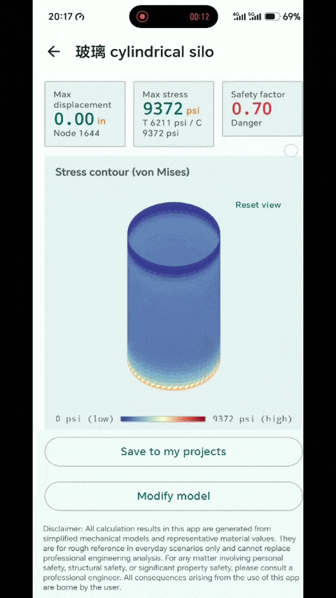
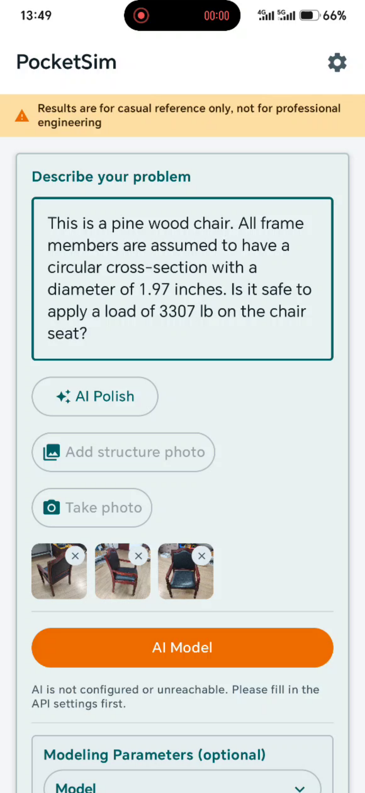
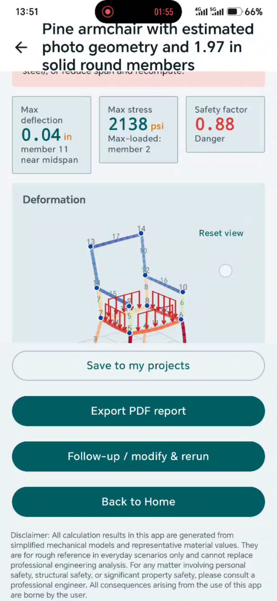
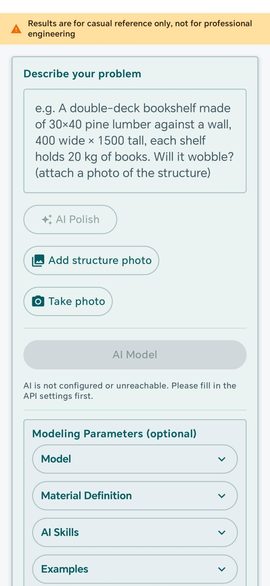
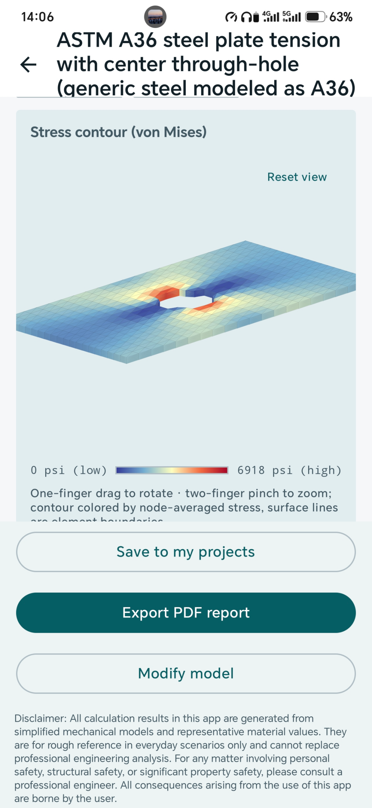
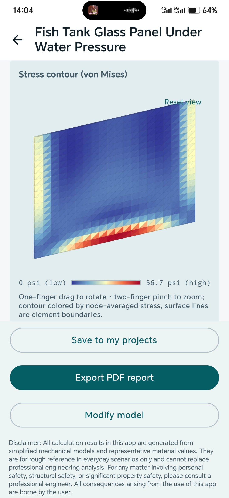
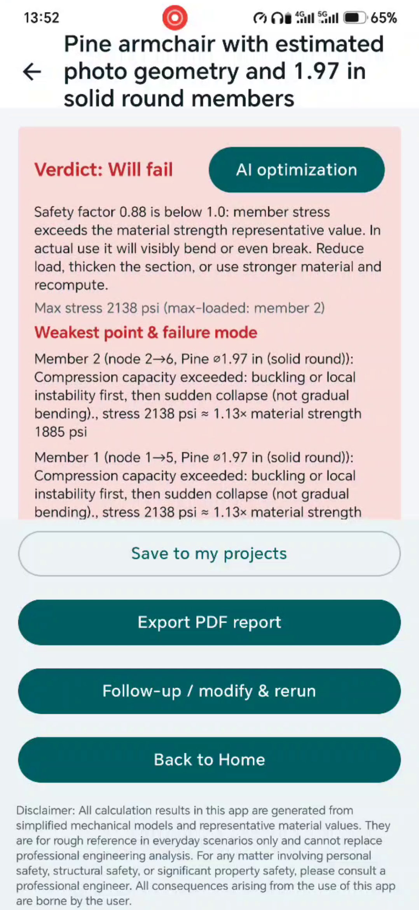
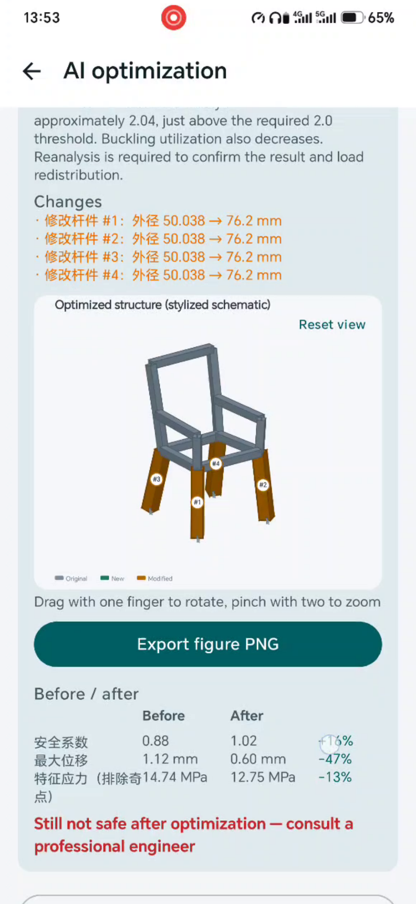
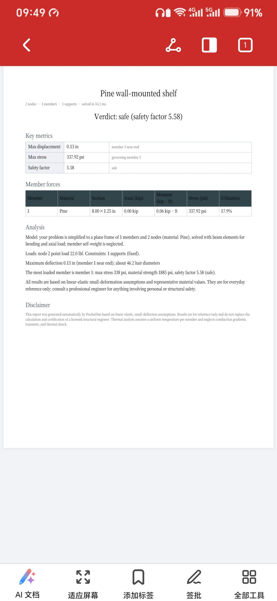
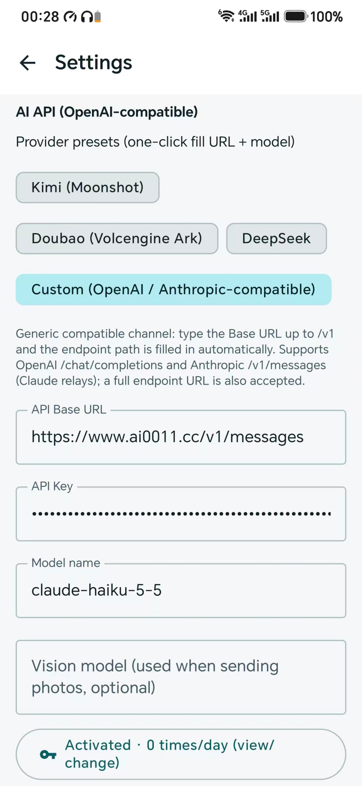

# PocketSim

**Will your bookshelf hold? Snap a photo and find out.**

PocketSim is a free Android finite element analysis (FEA) app with an [open-source solver engine](python/pocketsim/) (AGPL-3.0). Describe a structure in one sentence or take a photo: AI builds the model, and your phone solves it on the spot. No workstation, no CAE license, no FEM background.

[Download APK](https://github.com/battleq/PocketSim/releases) · [中文说明](README.zh-CN.md) · [Report an issue](https://github.com/battleq/PocketSim/issues)



[](https://github.com/battleq/PocketSim/releases)
[](https://github.com/battleq/PocketSim)
[](LICENSE)
[](android/)

> ⭐ If PocketSim saves you a trip to a workstation, a star helps other makers find it.

---

## Why PocketSim

| | Traditional CAE | PocketSim |
|---|---|---|
| Entry barrier | Meshing, boundary conditions, material models | One sentence or one photo |
| Cost | Expensive annual licenses + workstation | Free; solver engine open source, runs on a phone |
| Time | Hours of modeling | Seconds to tens of seconds |
| Output | Dense contour plots | A three-tier verdict: **Safe / Borderline / Not recommended** |

Everyday problems need risk awareness, not certified precision. PocketSim uses conservative material values and loads, applies a safety factor, and tells you which way the answer leans.

**Why not just ask a chatbot?** A language model writes a plausible sentence; it has no solver, so it cannot integrate the stiffness of *your* section, span and supports, and its assumptions stay invisible. PocketSim puts those assumptions on screen as editable fields and computes the number with finite elements. The longer argument, and where the line between the two should sit, is in [docs/why-pocketsim.md](docs/why-pocketsim.md).

## How It Works

1. **Describe or photograph** the part, or pick an example from the home screen.
2. **AI builds the model.** Geometry, material lookup and loads are filled in. You review them before anything is solved.
3. **The phone solves it locally** with scikit-fem inside an embedded Python 3.10 (Chaquopy). You get deflection, a stress contour and a safety verdict.

| Describe | Result |
|---|---|
|  |  |

## Use Cases

Each example below ships with the app. Tap it on the home screen to fill in the question and run.

- **Wall shelf sag** (structure): an 80 cm pine shelf with 10 kg of books; what is the maximum deflection?
- **Pipe weld under heat** (thermal): a 2 m steel pipe welded at both ends, heated from 20 °C to 150 °C; will the welds crack?
- **Garden wall in a storm** (wind & seepage): a 2 × 3 m brick wall in an 8-Beaufort gale; or a 12 m concrete dam with an 11 m reservoir; will it leak or slide?
- **Aquarium glass** (3D solid): an 8 mm glass panel holding 40 cm of water; or a 10 cm balcony slab with four adults on it.
- **Water tank & glass cup** (thin-wall container): a 6 mm steel tank filled to 1.2 m; or a glass cup filled with boiling water and moved straight into a fridge.
- **PVC pipe under a road** (buried pipe): a 50 mm PVC pipe 2 m underground with vehicles passing overhead.

## Highlights

- 📱 **On-device**: solving runs offline on your phone.
- 🤖 **AI-assisted**: a photo or a sentence becomes a model; no FEM background needed.
- 🧱 **Multiple physics**: beams and frames, 3D solids, thin-walled containers, buried pipes, thermal history, seepage, wind.
- 🔒 **Bring your own key**: your provider, your key. Data stays on your phone.
- 🌐 **Bilingual, dual units**: English / 中文, metric / imperial end to end.
- 🔓 **Open source**: the solver engine is AGPL-3.0.

## Screenshots

| | |
|---|---|
|  | **Home & examples**: start from a built-in example or describe your own part. |
|  | **3D preview**: inspect the model in space, with pinch-zoom and rotation. |
|  | **3D result**: deflection and stress shown on the 3D structure. |
|  | **AI optimization advice**: suggested structural changes, with a before/after 3D figure and numbered callouts tied to the change list. |
|  | **AI optimization result**: the optimized model re-solved, with before/after displacement and stress compared side by side. |
|  | **PDF report**: one-tap analysis report with the model, assumptions, contour plots and the safety verdict. |
|  | **Settings**: bring-your-own-key provider setup, language, units and reasoning effort. |

## Features

| Module | Description |
|---|---|
| Scene templates | Parameterized templates (cantilever shelf, wall-mounted rail, simply supported plank), solvable offline |
| 2D frame | Text or photo → beam-frame model, up to 60 nodes and 80 members, with member forces and deflection |
| 3D frame | 3D beam elements for arbitrary 3D bar systems |
| 3D solids | Walls and generic TET4 solids (box, cylinder, plate); stress contours and safety grading |
| Thin-walled containers | MITC4 shell elements for flat-bottom silos and rectangular tanks; wall stress and tension/compression checks |
| Buried pipe | Ring deflection, buckling and ring stress for buried PVC-type pipes (analytical formulas, non-FEM) |
| Thermal history | Thermal stress, heating and cooling cycles, material temperature-limit hints |
| Wind & seepage | Wind-load wall overturning check; dam seepage and sliding verification |
| AI modeling | Text and photo understanding, parameter follow-up, recompute; OpenAI- and Anthropic-compatible providers with a per-provider vision model |
| AI optimization advice | Suggests structural changes; before/after 3D figure with numbered callouts, numbered change list, PNG export |
| Material library | Built-in GB and ASTM materials; online lookup, manual add and delete |
| Results | Plain-language analysis, safety grading, member force table, PDF report and shareable image |

## Documentation

| Document | What's inside |
|---|---|
| [docs/why-pocketsim.md](docs/why-pocketsim.md) | Why FEM belongs in everyday life, and why a chatbot is not a solver |
| [docs/validation.md](docs/validation.md) | Measured error against closed-form solutions — including the unflattering cases |
| [docs/commercial-software-comparison.md](docs/commercial-software-comparison.md) | Cross-check against Autodesk Inventor 2027 on two benchmark parts |
| [docs/limitations.md](docs/limitations.md) | Supported elements, sections, loads and boundary conditions |
| [docs/faq.md](docs/faq.md) | Setup, providers, error messages, scope |
| [docs/user-guide.md](docs/user-guide.md) | Step-by-step walkthrough of every mode |
| [docs/performance-benchmarks.md](docs/performance-benchmarks.md) | Mesh sizes, DOF counts and solve times |

## Privacy & Disclaimer

> 🔒 **BYOK privacy**: AI modeling uses your own API key. Text and images go directly to the LLM provider you choose, **never through a PocketSim server**. The app does not collect or store your models or data.

> ⚠️ **For teaching, DIY and quick estimation only.** Results **must not be used for formal engineering design, structural certification or safety-critical applications**. Shared images carry a "For reference only" watermark. For safety-critical work, use professional CAE software and have a licensed engineer review the result.

## Quick Start

1. Install the [latest APK](https://github.com/battleq/PocketSim/releases), or build from source below.
2. Pick an example or a template on the home screen, or describe your own part.
3. Check the geometry, material, loads and supports the AI proposed, then tap **Run**.

Release updates are listed in [CHANGELOG.md](CHANGELOG.md).

## Build from Source

**Requirements:** JDK 17, Android SDK Platform 34 and Build Tools 34, Gradle 8.14 (or open `android/` in Android Studio). Python 3.10 is only needed for the Python tests.

```bash
cd android
export JAVA_HOME=/path/to/jdk17
gradle :app:assembleDebug        # app/build/outputs/apk/debug/app-debug.apk
gradle :app:testDebugUnitTest    # JVM unit tests, no device needed
```

Release builds need a signing key, which the repo does not include. `app/build.gradle.kts` reads `keystore.properties` and the JKS from `externalKeystoreDir`, currently hard-coded to `D:/ChuangXin/70_口袋仿真/keystore`; change that value for your machine. The password may come from the `KEYSTORE_PASS` environment variable. Changing the key will prevent over-the-air upgrades of already-installed older versions.

```bash
cd android
mkdir -p keystore
keytool -genkeypair -v -keystore keystore/pocketsim-release.jks -alias pocketsim \
        -keyalg RSA -keysize 2048 -validity 10950
# Then write the following into keystore/keystore.properties:
# storeFile=keystore/pocketsim-release.jks
# storePassword=******
# keyAlias=pocketsim
# keyPassword=******

gradle :app:assembleRelease \
  -x lintVitalAnalyzeRelease -x lintVitalReportRelease -x lintVitalRelease
# Output: app/build/outputs/apk/release/app-release.apk
```

Without signing configured, `assembleRelease` still produces an unsigned package that cannot be installed or upgraded directly.

**Python tests**

```bash
cd python
pip install -r requirements.txt
python -m pytest tests/test_frame.py tests/test_frame3d.py tests/test_materials.py
```

The `flow`, `solver` and `seepage` tests depend on `scikit-fem`; install the full dependencies to run the complete suite.

## Project Structure

```
pocketsim/
├── android/        # Android app (Kotlin + Compose + Chaquopy); see android/README.md
├── python/         # Solver engine (runs and tests standalone)
│   ├── pocketsim/  # engine, templates, frame, solid, shell, buried_pipe, seepage, ...
│   └── tests/      # pytest suite
├── screenshots/    # README screenshots
├── docs/           # limitations, benchmarks, design notes
├── LICENSE         # AGPL-3.0 (Python engine)
├── NOTICE.md       # tiered license scope, additional permissions, trademark
└── LICENSE-COMMERCIAL
```

## Contributing

Bug reports, material suggestions and feature requests are welcome through [Issues](https://github.com/battleq/PocketSim/issues). See [CONTRIBUTING.md](CONTRIBUTING.md) before opening a pull request.

## License & Terms

This project uses a **tiered license**; the full scope is defined in [NOTICE.md](NOTICE.md).

| Part | License | What you may do |
|---|---|---|
| `python/pocketsim/` solver engine | **AGPL-3.0-or-later** + commercial license | Study, modify and use commercially; distributing or offering it as a network service requires releasing the engine source. Buy a commercial license if you do not want to open-source. |
| `android/` client | **Proprietary (All Rights Reserved)** | No copying, modifying, closed-source distribution or commercial use without written permission |
| Name & icons | **Trademark reserved** | You may state the source truthfully; you may not impersonate the official build |

- AGPL text: [LICENSE](LICENSE)
- Tiered scope, Section 7 additional permission, trademark and contribution terms: [NOTICE.md](NOTICE.md)
- Commercial licensing: [LICENSE-COMMERCIAL](LICENSE-COMMERCIAL)

> This is the project's licensing policy, not legal advice. Have a lawyer review it before any commercial deal.

## Acknowledgments

- [scikit-fem](https://github.com/kinnala/scikit-fem): FEM discretization and matrix assembly, BSD-3-Clause
- [Chaquopy](https://chaquo.com/chaquopy/): embedded Python on Android, MIT
- [NumPy](https://numpy.org/) / [SciPy](https://scipy.org/): numerical computing, BSD
- [AndroidX / Jetpack Compose](https://developer.android.com/jetpack): Android UI, Apache-2.0
- [Trae](https://www.trae.ai/): versions after the prototype were developed with Trae's assistance; code reviewed and tested by the author. Trae does not endorse or warrant this product.

Third-party components follow their own licenses. The full dependency list is in the app under "Settings → Open Source Licenses".

---

[](https://star-history.com/#battleq/PocketSim&Date)
