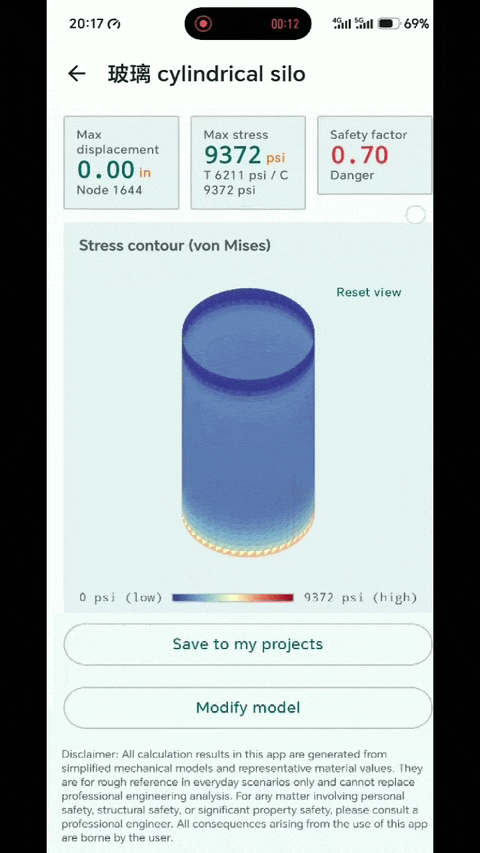
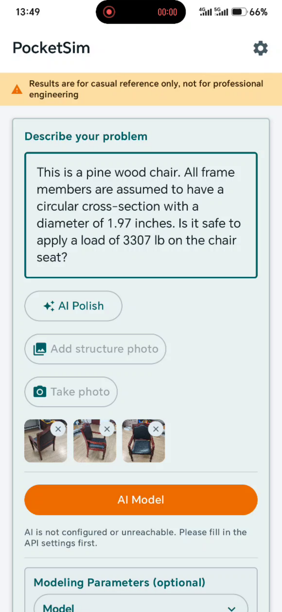
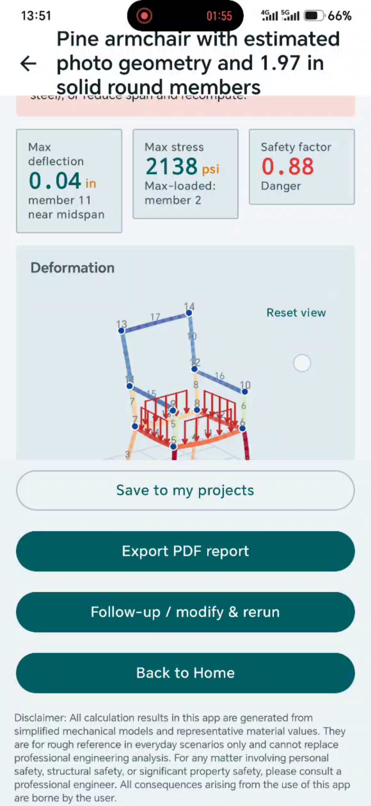
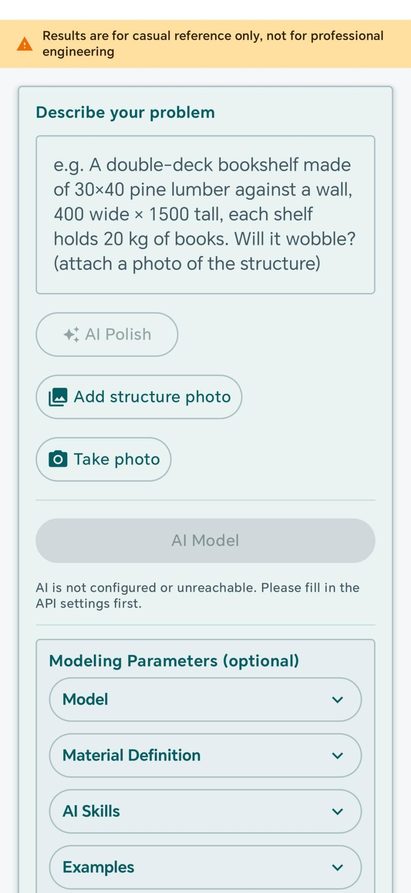
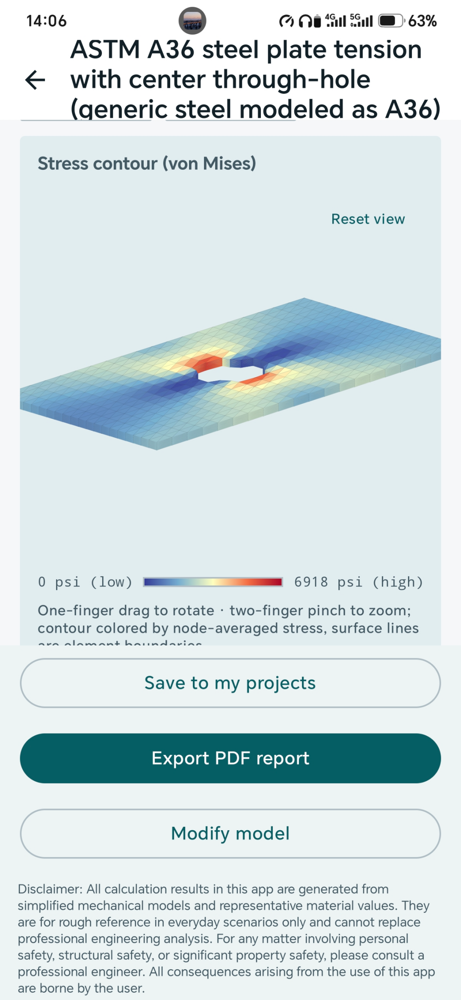
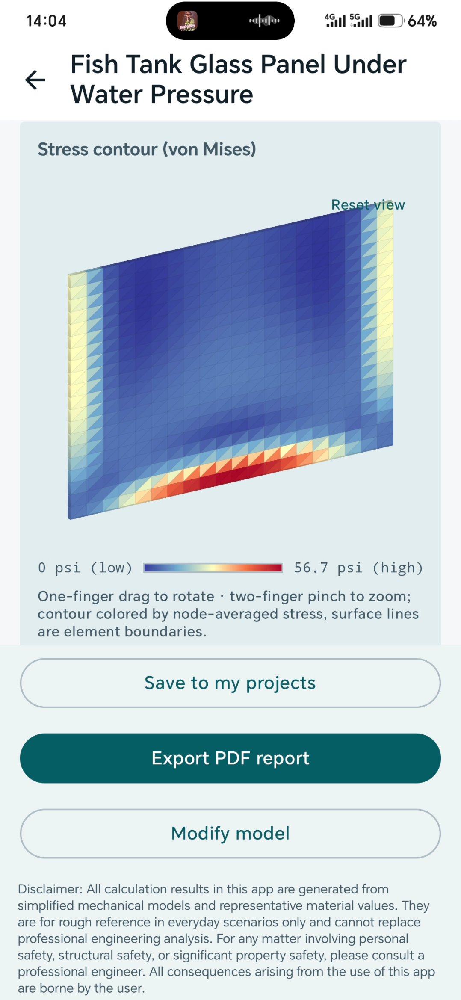
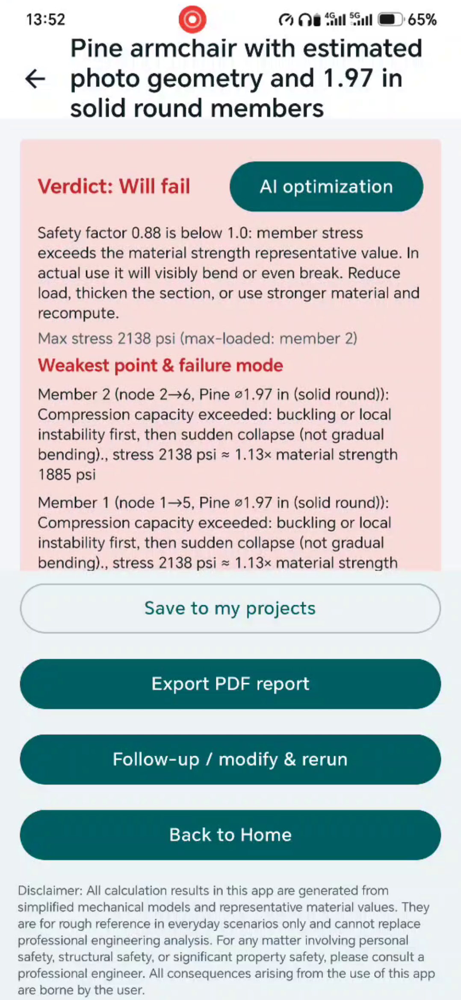
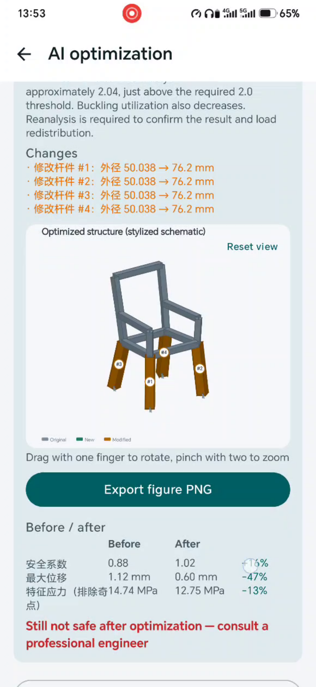
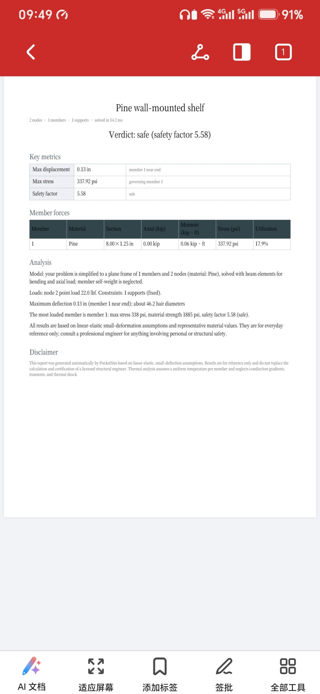
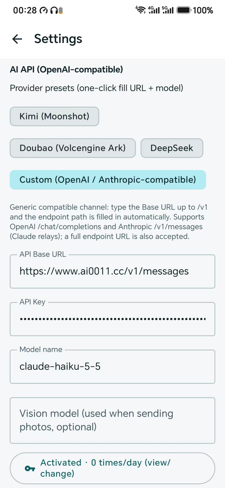

# PocketSim 口袋仿真

**你的书架能承重吗？拍一张照片就知道。**

PocketSim 是一款免费的安卓有限元分析（FEA）应用，[求解引擎开源](python/pocketsim/)（AGPL-3.0）。用一句话或一张照片描述构件，AI 生成模型，手机当场完成求解。无需工作站，无需 CAE 授权，也不要求有限元背景。

[下载 APK](https://github.com/battleq/PocketSim/releases) · [English](README.md) · [问题反馈](https://github.com/battleq/PocketSim/issues)



[](https://github.com/battleq/PocketSim/releases)
[](https://github.com/battleq/PocketSim)
[](LICENSE)
[](android/)

> ⭐ 如果 PocketSim 让你省下了去工作站的时间，点个 Star 能帮更多创客找到它。

---

## 为什么需要它

| | 传统 CAE | PocketSim |
|---|---|---|
| 门槛 | 要懂网格划分、边界条件、材料模型 | 一句话或一张照片 |
| 成本 | 年费授权 + 高性能工作站 | 免费；求解引擎开源，手机即可 |
| 耗时 | 建模常需数小时 | 几秒到几十秒 |
| 结论形式 | 一堆云图 | **安全 / 接近临界 / 不建议**三档判定 |

日常问题要的是风险预警，而不是认证级精度。PocketSim 取保守的材料参数与载荷，叠加安全系数，告诉你结果偏向哪一边。

**为什么不直接问 AI？** 语言模型能写出一段很像样的话，但它没有求解器：它无法对**你**的截面、跨度与支承组装刚度方程，而且它的假设是看不见的。PocketSim 把这些假设变成屏幕上可编辑的字段，用有限元算出那个数。完整论述、以及"AI 与求解器该怎么分工"，见 [docs/why-pocketsim.zh-CN.md](docs/why-pocketsim.zh-CN.md)。

坦白说，PocketSim 还很初级——一个不到 70 MB 的安装包，只做得动杆件、实体、容器这类小问题。和成熟的商业仿真软件相比，它只是海里的一滴水。但这滴水要做的事不同：让力学校核变得随手可得，而不是与海比大小。

## 工作方式

1. **描述或拍照**：输入构件，或从首页选一个示例。
2. **AI 建模**：补全几何、查询材料、设置载荷。求解前你可以检查并确认。
3. **手机本地求解**：基于 scikit-fem，运行在内嵌的 Python 3.10（Chaquopy）中，给出变形、应力云图与安全判定。

| 描述 | 结果 |
|---|---|
|  |  |

## 应用场景

下面每个示例都内置在 App 中，在首页点一下即可填入问题并开始分析。

- **墙上搁板会不会下垂**（承重结构）：80 cm 松木搁板，远端放 10 kg 书，最大挠度多少？
- **焊口受热会不会裂**（温度历程）：2 m 低碳钢管两端焊死，从 20 ℃ 升到 150 ℃，焊口会被顶裂吗？
- **围墙与大坝抗风抗渗**（风与渗流）：8 级大风下 2×3 m 砖墙会被吹倒吗？12 m 混凝土重力坝上游水深 11 m，会渗漏或滑动吗？
- **鱼缸玻璃与阳台楼板**（三维实体）：8 mm 玻璃板承受 40 cm 水深，会不会裂？10 cm 钢筋混凝土阳台板站上 4 个成年人呢？
- **水箱鼓胀与玻璃杯炸裂**（薄壁结构）：6 mm 钢制水箱装 1.2 m 深水，罐壁会鼓胀吗？玻璃杯倒入沸水后直接放进冰箱，会不会因温度应力炸裂？
- **埋在路下的 PVC 管**（埋地管）：直径 50 mm、埋深 2 m 的 PVC 管，上方有车辆经过，会损坏吗？

## 亮点

- 📱 **本地运行**：求解在手机上离线完成。
- 🤖 **AI 辅助**：照片或一句话生成模型，无需有限元基础。
- 🧱 **多物理场**：梁杆框架、薄壁容器、埋地管、三维实体、温度、渗流、风。
- 🔒 **自带密钥**：用你自己的服务商与 Key，数据留在手机上。
- 🌐 **双语双单位**：中文 / English 一键切换，公制 / 英制全链路。
- 🔓 **开源**：求解引擎采用 AGPL-3.0。

## 截图

| | |
|---|---|
|  | **首页与示例**：从内置示例开始，或描述你自己的构件。 |
|  | **三维预览**：在空间中检查模型，支持双指缩放与旋转。 |
|  | **三维结果**：在三维结构上查看变形与应力云图。 |
|  | **AI 优化建议**：给出结构优化方案，前后对比三维图与编号改动清单一一对应。 |
|  | **AI 优化结果**：优化后模型重算，改进前后的位移与应力指标并列对比。 |
|  | **PDF 报告**：一键导出分析报告，含模型、假设、云图与安全判定。 |
|  | **设置**：配置自带密钥的模型服务商、语言、单位与推理强度。 |

## 功能概览

| 模块 | 说明 |
|---|---|
| 场景模板 | 悬臂搁板、墙上钉挂重、简支层板等参数化模板，离线可算 |
| 通用结构（2D） | 文字或照片 → 梁杆框架，节点不超过 60、杆件不超过 80，给出内力与变形 |
| 空间框架（3D） | 空间梁单元，支持任意三维杆系 |
| 三维实体 | 墙体与通用 TET4 实体（箱体、圆柱、板），应力云图与安全分级 |
| 薄壁容器 | 等壁厚平底容器的 MITC4 壳单元（圆柱料仓、矩形水箱），壁面应力与拉压强度校核 |
| 埋地管 | PVC 等埋地管的环形变形、屈曲与环向应力校核（解析公式，非有限元） |
| 温度历程 | 热应力、升温降温循环，材料耐温提示 |
| 风与渗流 | 风压墙体抗倾覆、大坝渗流与滑动校核 |
| AI 建模 | 文字与照片理解、参数追问、结果追问重算；支持 OpenAI 与 Anthropic 兼容接口，视觉模型按厂商分别配置 |
| AI 优化建议 | 给出结构优化方案；前后对比三维示意图、编号改动清单、PNG 导出 |
| 材料库 | 国标与美标内置材料，支持联网检索、手动添加与删除 |
| 结果表达 | 通俗分析、安全分级、杆件内力表、PDF 报告与分享图 |

## 文档

| 文档 | 内容 |
|---|---|
| [docs/why-pocketsim.zh-CN.md](docs/why-pocketsim.zh-CN.md) | 为什么把有限元用进日常，以及为什么聊天机器人不是求解器 |
| [docs/validation.zh-CN.md](docs/validation.zh-CN.md) | 相对解析解的实测误差——包括不好看的那些 |
| [docs/commercial-software-comparison.zh-CN.md](docs/commercial-software-comparison.zh-CN.md) | 与 Autodesk Inventor 2027 在两个基准件上的交叉对比 |
| [docs/limitations.zh-CN.md](docs/limitations.zh-CN.md) | 支持的单元、截面、荷载与边界条件 |
| [docs/faq.zh-CN.md](docs/faq.zh-CN.md) | 配置、服务商、报错、适用范围 |
| [docs/user-guide.zh-CN.md](docs/user-guide.zh-CN.md) | 各模式的逐步使用说明 |
| [docs/performance-benchmarks.zh-CN.md](docs/performance-benchmarks.zh-CN.md) | 网格规模、自由度与求解耗时 |

## 隐私与免责声明

> 🔒 **BYOK 隐私模式**：AI 建模由你自行填写 API Key，图片与文字直接发送到你自选的 LLM 服务商，**不经过 PocketSim 的任何服务器**。App 不收集、不存储你的模型与数据。

> ⚠️ **仅用于教学、DIY 与日常估算。** 仿真结果**不可用于正式工程设计、结构认证或安全关键场景**。分享图自动附加「仅供参考」水印。安全关键应用请使用专业 CAE 软件，并由持证工程师复核。

## 快速上手

1. 下载[最新 APK](https://github.com/battleq/PocketSim/releases)，或按下文从源码构建。
2. 在首页选一个示例或场景模板，或描述你自己的构件。
3. 检查 AI 给出的几何、材料、载荷与支承，点击 **开始分析**。

版本更新见 [CHANGELOG.zh-CN.md](CHANGELOG.zh-CN.md)。

## 从源码构建

**环境要求：** JDK 17、Android SDK Platform 34 与 Build Tools 34、Gradle 8.14（或直接用 Android Studio 打开 `android/`）。仅运行 Python 测试时需要 Python 3.10。

```bash
cd android
export JAVA_HOME=/path/to/jdk17
gradle :app:assembleDebug        # app/build/outputs/apk/debug/app-debug.apk
gradle :app:testDebugUnitTest    # JVM 单元测试，不需要真机
```

Release 包需要签名密钥，仓库不包含密钥。`app/build.gradle.kts` 从 `externalKeystoreDir` 读取 `keystore.properties` 与 JKS，当前硬编码为 `D:/ChuangXin/70_口袋仿真/keystore`，其他机器请修改该值；密码可通过环境变量 `KEYSTORE_PASS` 提供。**更换密钥会导致无法覆盖升级已安装的旧版本。**

```bash
cd android
mkdir -p keystore
keytool -genkeypair -v -keystore keystore/pocketsim-release.jks -alias pocketsim \
        -keyalg RSA -keysize 2048 -validity 10950
# 然后在 keystore/keystore.properties 写入：
# storeFile=keystore/pocketsim-release.jks
# storePassword=******
# keyAlias=pocketsim
# keyPassword=******

gradle :app:assembleRelease \
  -x lintVitalAnalyzeRelease -x lintVitalReportRelease -x lintVitalRelease
# 产物：app/build/outputs/apk/release/app-release.apk
```

未配置签名时 `assembleRelease` 仍会生成未签名包，无法直接安装或升级。

**Python 测试**

```bash
cd python
pip install -r requirements.txt
python -m pytest tests/test_frame.py tests/test_frame3d.py tests/test_materials.py
```

`flow`、`solver`、`seepage` 相关用例依赖 `scikit-fem`，安装完整依赖后可运行全量测试。

## 工程结构

```
pocketsim/
├── android/        # 安卓应用（Kotlin + Compose + Chaquopy），专有软件——许可见 android/LICENSE
├── python/         # 求解引擎（可独立运行与测试）
│   ├── pocketsim/  # engine、templates、frame、solid、shell、buried_pipe、seepage 等
│   └── tests/      # pytest 用例
├── screenshots/    # README 截图
├── docs/           # 能力边界、性能基准、设计笔记
├── LICENSE         # AGPL-3.0（Python 引擎）
├── NOTICE.md       # 分层授权范围、附加许可、商标
└── LICENSE-COMMERCIAL
```

## 参与贡献

欢迎通过 [Issues](https://github.com/battleq/PocketSim/issues) 提交缺陷报告、材料建议与功能需求。提交 Pull Request 前请先阅读 [贡献指南](CONTRIBUTING.zh-CN.md)。

## 许可证与权益说明

本项目采用**分层授权**，完整范围以 [NOTICE 授权说明](NOTICE.zh-CN.md) 为准。

| 部分 | 授权 | 你可以做什么 |
|---|---|---|
| `python/pocketsim/` 求解引擎 | **AGPL-3.0-or-later** + 商业授权 | 学习、修改、商用均可；分发或提供网络服务时须公开引擎完整源码。不愿开源可购买商业授权。 |
| `android/` 客户端 | **专有（All Rights Reserved）** | 未经书面许可不得复制、修改、闭源分发或商用 |
| 名称与图标 | **商标保留** | 可如实说明来源，不得冒充官方版本 |

- AGPL 原文（Python 引擎）：[LICENSE](LICENSE)
- 安卓客户端（专有，保留所有权利）：[android/LICENSE](android/LICENSE)
- 分层范围、第 7 条附加许可、商标与贡献约定：[NOTICE 授权说明](NOTICE.zh-CN.md)
- 商业授权咨询：[LICENSE-COMMERCIAL](LICENSE-COMMERCIAL)

> 以上为项目授权政策，不构成法律意见。如需对外商业化，建议请律师审阅后再签约。

## 致谢

- [scikit-fem](https://github.com/kinnala/scikit-fem)：有限元离散与矩阵装配，BSD-3-Clause
- [Chaquopy](https://chaquo.com/chaquopy/)：安卓内嵌 Python，MIT
- [NumPy](https://numpy.org/) / [SciPy](https://scipy.org/)：数值计算，BSD
- [AndroidX / Jetpack Compose](https://developer.android.com/jetpack)：安卓界面，Apache-2.0
- [Trae](https://www.trae.ai/)：原型之后的版本在 Trae 的辅助下开发，代码经作者审阅与测试；Trae 未对本产品提供背书或担保。

第三方组件遵循各自许可。完整依赖清单见 App 内「设置 → 开源许可」页面。

---

[](https://star-history.com/#battleq/PocketSim&Date)
