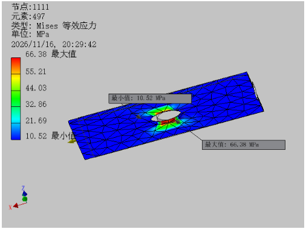
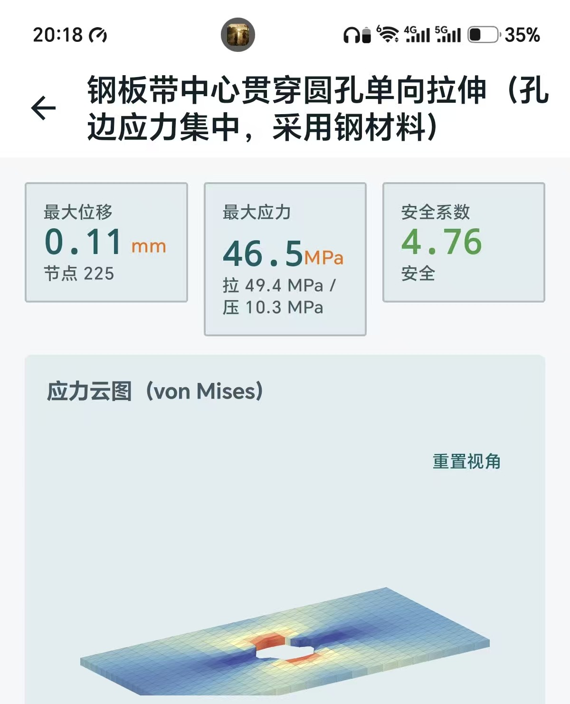
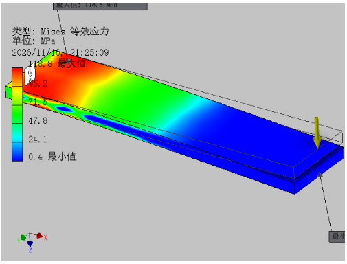
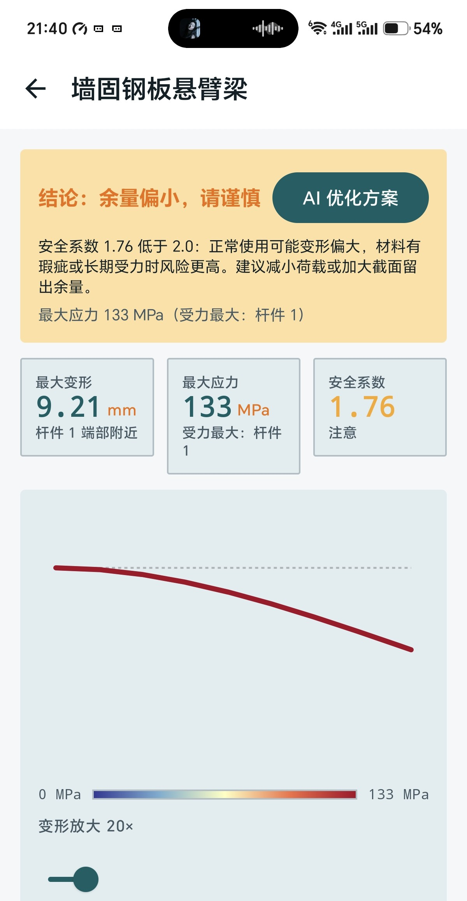

# Cross-check against commercial FEM software (Autodesk Inventor 2027)

> 中文 · [commercial-software-comparison.zh-CN.md](commercial-software-comparison.zh-CN.md)

> [validation.md](validation.md) measures PocketSim against textbook closed-form solutions.
> This page measures it against a **commercial FE engine** — Autodesk Inventor 2027 —
> on two hand-built benchmark parts: same geometry, same load, same material where possible.
> Both flattering and unflattering results are reported, with the physics explained.

Date of comparison: **2026-11-16**. Inventor results were produced with the user's own
Inventor 2027 study reports; PocketSim results come from the shipped app (v1.2.35).

## Why compare at all?

A closed-form check proves the equations are implemented correctly. A commercial-FEM check
answers a different question: *does the whole pipeline — modeling assumptions, meshing,
solve, result extraction — land in the same place as a professional tool a reviewer would trust?*

The two cases below deliberately probe opposite regimes: one where PocketSim's solid solver
is at its weakest (a stress concentration, run at both the coarsest and the finest mesh),
and one where it is exact by construction (beam mode on a slender beam).

## Case 1 — Perforated plate in axial tension (solid mode, coarse vs. ultra mesh)

**Model**: steel plate 1000 × 500 × 20 mm, central circular hole Ø ≈ 160 mm,
200 kN tensile load across the 500 mm width, far end fixed.
The same model was solved twice in PocketSim — default coarse mesh and the highest
**ultra** mesh level — to test mesh convergence against the commercial reference.

| Quantity | PocketSim coarse (225 nodes) | PocketSim **ultra** (10 312 nodes) | Inventor 2027 (curved elements, hole-edge refinement) | Closed-form estimate |
|---|---|---|---|---|
| Max displacement | 0.11 mm | 0.11 mm | 0.1083 mm | — |
| Max von Mises stress | 46.5 MPa | **50.3 MPa** (+8.2 %) | **66.38 MPa** | ≈ 68 MPa |
| Safety factor | 4.76 | 4.42 | 3.12 | ≈ 3.0–3.3 |

**Theory check.** Net-section stress σ_net = 200 000 N ÷ [(500 − 160) × 20 mm²] = 29.4 MPa.
Finite-width stress concentration factor, d/W = 0.32:
Kt ≈ 3.00 − 3.14(d/W) + 3.667(d/W)² − 1.527(d/W)³ ≈ 2.32 → peak ≈ **68 MPa**.
Inventor's 66.4 MPa matches theory.

**What the mesh sweep shows.**

1. **Global response is mesh-independent and already matches**: displacement stays 0.11 mm
   at both levels, within ~2 % of Inventor. The stiffness, load path and boundary conditions
   are right — the remaining difference is purely local peak resolution.
2. **Refining the mesh moves the peak in the correct direction**: 46.5 → 50.3 MPa
   (+8.2 %) with ~46× more nodes, closing part of the gap toward 66–68 MPa.
3. **But convergence is slow — and this is expected physics, not a bug.** PocketSim's solid
   solver uses **linear (constant-strain) tetrahedra (TET4)** with node-averaged output.
   TET4 elements are artificially stiff and their piecewise-constant stress field must
   resolve an r⁻²-type gradient near the hole edge through element subdivision alone;
   node averaging then smooths the remaining peak. A quadratic (curved) element — what
   Inventor uses at its default study settings — captures the same gradient with far fewer
   degrees of freedom. Hence even the ultra level reads ≈ 24 % below theory.

**Honest takeaway.** For stress concentrations, PocketSim's solid mode **underestimates peak
stress at every mesh level**, monotonically improving as the mesh is refined. Treat any
solid-mode peak as a **lower bound**; for a defensible peak at a hole or fillet, cross-check
against the hand Kt formula (as done above) rather than trusting a single mesh level.

| PocketSim result — coarse mesh | PocketSim result — ultra mesh |
|---|---|
|  |  |

## Case 2 — Steel cantilever beam (beam mode vs solid mesh)

**Model**: steel beam 800 × 200 × 30 mm, root fully fixed, 5 000 N transverse tip load.
PocketSim analyzed it in **beam (frame) mode** (Euler–Bernoulli); Inventor meshed it as a
**3D solid** with default coarse curved elements.

| Quantity | Theory (E = 206 GPa) | PocketSim (beam mode) | Inventor 2027 (solid, coarse) |
|---|---|---|---|
| Max displacement | 9.21 mm | **9.21 mm** | 7.86 mm (13 % too stiff) |
| Max bending stress (root) | 133.3 MPa | **133 MPa** | 118.8 MPa von Mises (11 % low) |
| Safety factor | — | 1.76 (Q235, yield 235 MPa) | 1.74 (yield 207 MPa) |

**Theory.** I = 200 × 30³ / 12 = 4.5 × 10⁵ mm⁴; M = P·L = 4 × 10⁶ N·mm;
σ = M·c / I = 133.3 MPa; δ = P·L³ / 3EI = 9.21 mm (E = 206 GPa) / 9.03 mm (E = 210 GPa).

**Why the gap runs the other way here.** PocketSim's beam element *is* the closed-form theory,
so agreement is exact by construction (see [validation.md](validation.md), 0.00 % on cantilever
cases). Inventor's coarse solid mesh — ~82 mm average element on a 30 mm-thick plate, only 1–2
elements across the thickness — under-resolves bending and reads **too stiff**, under-predicting
both displacement and stress by 11–13 %. Its local 143–165 MPa spikes at the loaded corner are
load-application singularities, not usable results.

The near-equal safety factors (1.76 vs 1.74) are a coincidence of two different
under-estimations cancelling: different yield strengths (235 vs 207 MPa) and different stress levels.

| Inventor 2027 result — cantilever | PocketSim result — cantilever |
|---|---|
|  |  |

## What the two cases say together

| Situation | Most trustworthy result | Why |
|---|---|---|
| Slender beam/frame, global response | PocketSim beam mode | Implements the exact engineering theory; commercial coarse solids can under-resolve bending |
| Stress concentration in a solid | Hand Kt check or commercial FEM with refinement | PocketSim solid peaks are lower bounds at every mesh level; linear tets converge slowly on r⁻² gradients |
| Overall stiffness / displacement | Either | Agreement within ~2 % once loads and BCs match, and mesh-independence confirmed on the PocketSim side |

**Practical guidance for PocketSim users**

1. Frame/beam-like structures → **beam mode**: results are theory-exact.
2. Solid parts with holes, fillets, notches → raise the mesh level (coarse → ultra moved the
   peak +8 % here) **and** cross-check the peak against a hand Kt estimate; treat the app's
   solid-mode stress as a lower bound.
3. Always sanity-check displacement and reaction balance first — if those agree with a
   reference run, a stress gap is almost always a mesh-resolution story, not a wrong model.

## Limitations of this comparison

- Single geometry per case; the mesh sweep covers only two PocketSim levels (coarse, ultra).
  Extrapolation to even finer meshes is qualitative (monotone convergence), not a fit.
- Material data differed slightly (yield 221/235 vs 207 MPa; E 206 vs 210 GPa).
- Inventor used its default study settings; PocketSim results reflect the out-of-the-box
  phone experience at each selected level.
- PocketSim is a teaching/DIY/quick-estimation tool. For safety-critical design, professional
  CAE with a licensed engineer's review remains mandatory (see [limitations.md](limitations.md)).
