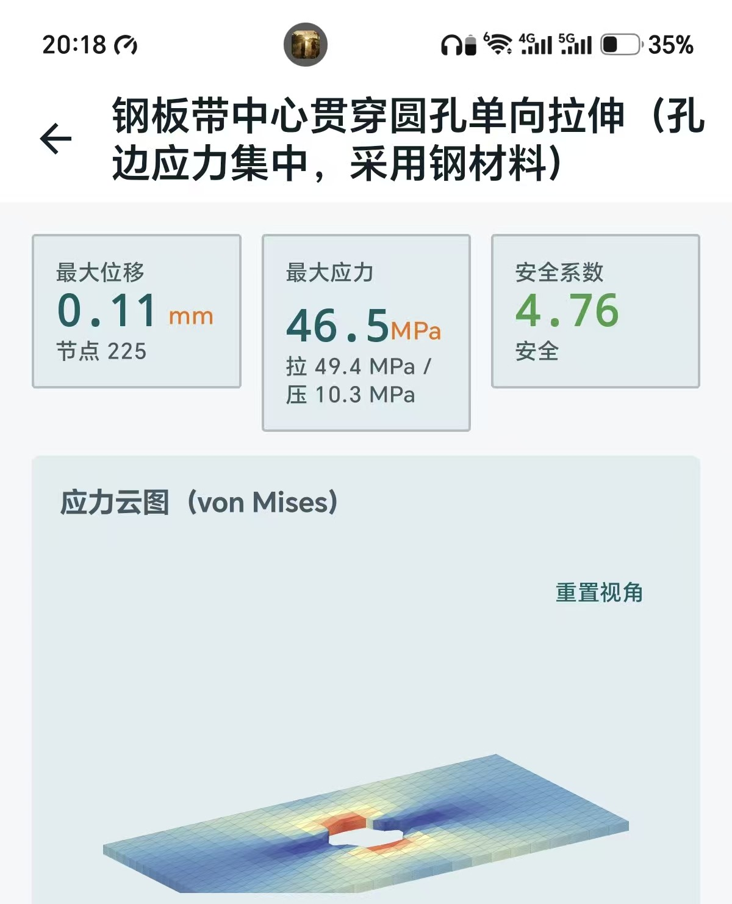
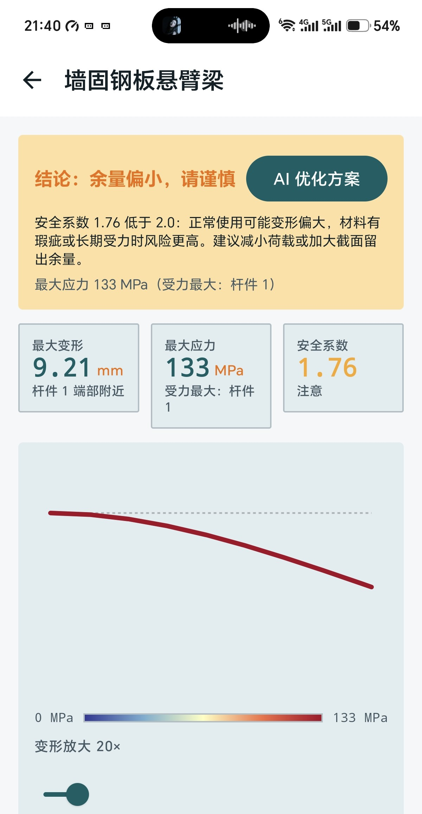

# 与商业有限元软件（Autodesk Inventor 2027）交叉对比

> English · [commercial-software-comparison.md](commercial-software-comparison.md)

> [validation.zh-CN.md](validation.zh-CN.md) 用教科书解析解检验 PocketSim；本页则与**商业 FE 引擎**——Autodesk Inventor 2027——在两个手工建模基准件上对比：相同几何、相同载荷、材料尽量一致。好看与不好看的结果都如实呈现，并解释背后的力学原因。

对比日期：**2026-11-16**。Inventor 数据来自用户本人的 Inventor 2027 研究报告；PocketSim 数据来自随版 App（v1.2.35）。

## 为什么要和商业软件比？

解析解校核证明"方程实现正确"；商业 FE 对比回答另一个问题：*从建模假设、网格、求解到结果提取的整条链路，是否与评审专家信任的专业工具落在同一量级？*

以下两个案例刻意覆盖相反区间：一个是 PocketSim 实体模式最弱的场景（应力集中，且分别在最粗与最细两档网格下求解以检验收敛趋势），一个是它按构造即精确的场景（梁模式 + 细长梁）。

## 案例一：带中心圆孔钢板轴向拉伸（实体模式，粗网格 vs ultra 网格）

**模型**：钢板 1000 × 500 × 20 mm，中心圆孔 Ø ≈ 160 mm，500 mm 宽面上施加 200 kN 拉力，远端固定。
同一模型在 PocketSim 中求解两次——默认粗网格与最高 **ultra** 档——用于检验向商业参考解的网格收敛性。

| 指标 | PocketSim 粗网格（225 节点） | PocketSim **ultra**（10 312 节点） | Inventor 2027（二次单元 + 孔边细化） | 理论估算 |
|---|---|---|---|---|
| 最大位移 | 0.11 mm | 0.11 mm | 0.1083 mm | — |
| 最大 von Mises 应力 | 46.5 MPa | **50.3 MPa**（+8.2 %） | **66.38 MPa** | ≈ 68 MPa |
| 安全系数 | 4.76 | 4.42 | 3.12 | ≈ 3.0–3.3 |

**理论校核**：净截面应力 σ_net = 200 000 N ÷ [(500 − 160) × 20 mm²] = 29.4 MPa；
有限宽板应力集中系数（d/W = 0.32）：Kt ≈ 3.00 − 3.14(d/W) + 3.667(d/W)² − 1.527(d/W)³ ≈ 2.32
→ 峰值 ≈ **68 MPa**。Inventor 的 66.4 MPa 与理论高度吻合。

**网格扫描说明了什么。**

1. **整体响应与网格无关且已经对齐**：两档位移均为 0.11 mm，与 Inventor 相差 ~2% 以内。
   刚度、载荷路径、边界条件都是对的——剩下的差距纯属局部峰值分辨率。
2. **细化网格使峰值向正确方向逼近**：节点数增至 ~46 倍，峰值 46.5 → 50.3 MPa（+8.2%），
   朝 66–68 MPa 收敛了一部分。
3. **但收敛很慢——这是预期内的物理特性，不是缺陷。** PocketSim 实体求解使用
   **线性常应变四面体（TET4）** + 节点平均输出：TET4 人工偏刚，分片常数的应力场只能靠
   单元细分去逼近孔边 r⁻² 型梯度，节点平均又抹平了剩余峰值。而 Inventor 默认设置使用
   二次（弯曲）单元，同样梯度用远少的自由度即可捕捉。因此 ultra 档仍比理论低约 24%。

**诚实结论**：应力集中问题上，PocketSim 实体模式**在任何网格档位都低估峰值应力**，
随网格细化单调改善。实体模式峰值应视为**下限**；孔/圆角处要给出可信峰值，
请配合手算 Kt 公式交叉校核（如上文所示），不要只信单一档位。

| PocketSim 结果——粗网格 | PocketSim 结果——ultra 网格 |
|---|---|
|  |  |

## 案例二：钢板悬臂梁（梁模式 vs 实体网格）

**模型**：钢梁 800 × 200 × 30 mm，根部固支，自由端横向集中力 5 000 N。
PocketSim 用**梁（框架）模式**（Euler–Bernoulli）分析；Inventor 按**三维实体**默认粗网格分析。

| 指标 | 理论（E = 206 GPa） | PocketSim（梁模式） | Inventor 2027（实体·粗网格） |
|---|---|---|---|
| 最大位移 | 9.21 mm | **9.21 mm** | 7.86 mm（偏刚 13%） |
| 最大弯曲应力（根部） | 133.3 MPa | **133 MPa** | 118.8 MPa（偏低 11%） |
| 安全系数 | — | 1.76（Q235，屈服 235 MPa） | 1.74（屈服 207 MPa） |

**理论**：I = 200 × 30³ / 12 = 4.5 × 10⁵ mm⁴；M = P·L = 4 × 10⁶ N·mm；
σ = M·c / I = 133.3 MPa；δ = P·L³ / 3EI = 9.21 mm（E = 206 GPa）/ 9.03 mm（E = 210 GPa）。

**这次差距方向反过来了**：PocketSim 的梁单元就是闭式解本身，按构造精确
（见 [validation.zh-CN.md](validation.zh-CN.md) 悬臂工况 0.00%）。
Inventor 默认粗实体网格（平均单元 ≈ 82 mm，30 mm 板厚仅 1~2 个单元跨厚度）弯曲欠收敛，
**偏刚**，位移与应力同时低估 11~13%；加载角点 143~165 MPa 局部峰值是施加方式奇点，不应采信。
两边安全系数接近（1.76 vs 1.74）纯属巧合——屈服强度取值不同（235 vs 207 MPa）且应力水平双双偏低。

## 两个案例合起来说明什么

| 场景 | 更可信的一方 | 原因 |
|---|---|---|
| 梁/框架类整体响应 | PocketSim 梁模式 | 实现的即精确工程理论；商业软件粗实体网格反而可能欠分辨率 |
| 实体件孔/角/缺口应力集中 | 手算 Kt 校核或细化网格的商业 FEM | PocketSim 实体峰值各档位均为下限；线性四面体对 r⁻² 梯度收敛慢 |
| 整体刚度 / 位移 | 两者皆可 | 载荷与约束一致时相差 ~2% 以内，且 PocketSim 侧已验证网格无关性 |

**给 PocketSim 用户的实操建议**

1. 梁柱类结构 → 用**梁模式**，结果即理论精确解；
2. 带孔/圆角/缺口的实体件 → 调高网格档位（本例粗 → ultra 峰值 +8%）**并且**用手算 Kt
   交叉校核峰值；实体模式应力一律视为下限；
3. 对比任何参考解时先看位移与反力平衡——这两项一致，应力差距基本都是网格分辨率问题，
   而不是模型建错。

## 本对比的局限

- 每例仅一个几何；PocketSim 侧网格扫描只覆盖两档（粗、ultra），向更细网格的外推是
  定性结论（单调收敛），不是拟合；
- 材料参数两侧略有差异（屈服 221/235 vs 207 MPa；E 206 vs 210 GPa）；
- Inventor 使用默认研究设置；PocketSim 结果反映手机上所选档位的开箱体验；
- PocketSim 定位为教学/DIY/快速估算工具；安全关键设计仍必须使用专业 CAE 并经注册工程师
  审查（见 [limitations.zh-CN.md](limitations.zh-CN.md)）。
